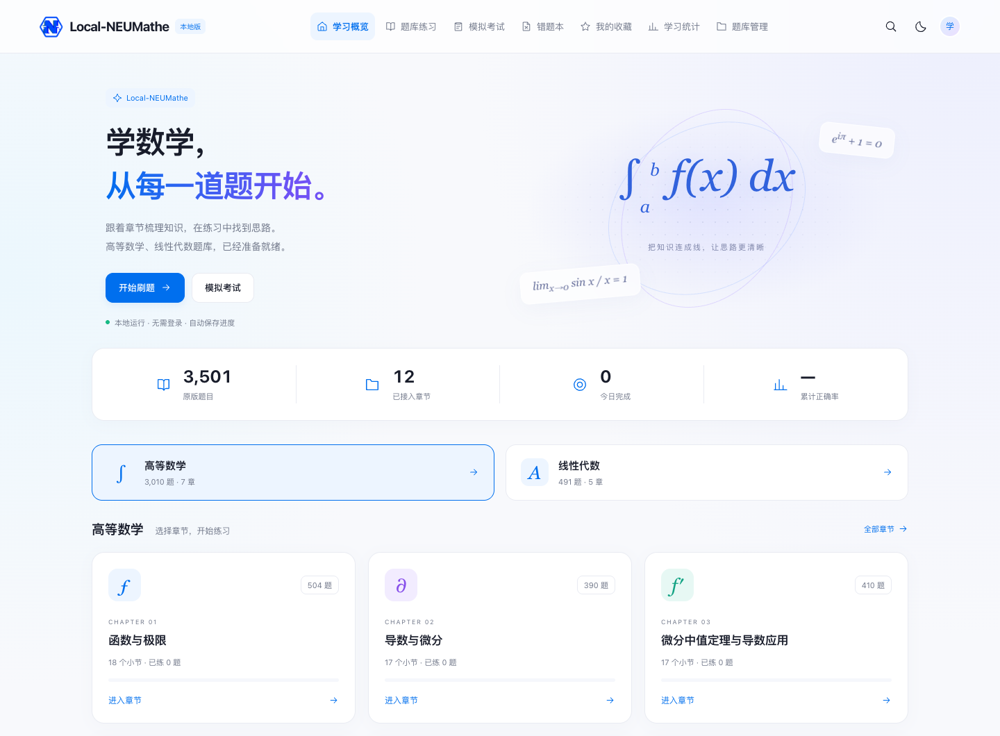

# Local-NEUMathe

参考 NeuMathe 交互风格的本地数学刷题网站，支持高等数学与线性代数。
题干、公式、图形和解析直接展示所提供 PDF 的原版面，学习记录保存在本机浏览器。



## 题库

| 科目     | 章节 | PDF / 小节 | 题目 |
| -------- | ---: | ---------: | ---: |
| 高等数学 |    7 |        122 | 3010 |
| 线性代数 |    5 |         10 |  491 |
| 合计     |   12 |        132 | 3501 |

高等数学涵盖函数与极限、导数与微分、微分中值定理与导数应用、积分及其应用、无穷级数、空间解析几何与向量代数、多元函数微分学。
线性代数涵盖行列式、矩阵及其运算、向量组与矩阵的秩、特征值与相似对角化、二次型。

当前题库均为单选题。答案通过 PDF 中的“【答案】”标记及加粗选项圈交叉核验，
与原文件标记一致；这不代表重新验证了原题数学答案。
7 道高等数学原题未附解析，页面会如实标注，不补写内容。

## 本地运行

需要 Python 3.9 或更新版本。克隆仓库后，在项目目录执行：

```sh
git clone https://github.com/PilotMiku/Local-NEUMathe.git
cd Local-NEUMathe
python3 -m venv .tools/pdf
.tools/pdf/bin/python -m pip install -r requirements.txt
.tools/pdf/bin/python server.py --port 4178
```

打开 <http://127.0.0.1:4178/>。服务仅监听本机，无需前端构建或 NeuMathe 在线账号。
请使用项目的 `server.py`，普通静态文件服务器无法生成 PDF 题图。

macOS 安装依赖后，也可双击 `启动网站.command` 在后台运行；双击 `停止网站.command` 停止。
后台服务属于当前用户会话，关闭终端后仍可使用，电脑重启后需重新启动。
其他系统可使用上面的 Python 命令在前台运行。

## 功能

- 按科目、章节和小节筛选；顺序练习、随机 20 题、单题练习。
- 自动判分、原题解析、原 PDF 页码跳转；长公式支持横向滑动。
- 收藏、错题本、掌握标记、学习统计和练习进度自动保存。
- 限时模拟考试、到时交卷、成绩报告及逐题回顾。
- JSON 题库导入、完整备份导出与恢复；兼容项目旧版备份。
- 手机布局、明暗主题；内置 PDF 题库更新时自动升级，保留已有题目的学习记录。

学习数据保存在当前浏览器的 IndexedDB。项目改名沿用旧版存储键以保留进度。
建议始终使用 `http://127.0.0.1:4178/`；`localhost` 与 `127.0.0.1` 的浏览器数据彼此独立。
清理浏览器或更换设备前请导出完整备份。PDF 图片依赖本项目服务器及原文件，
备份 JSON 不包含原 PDF，迁移时需保留仓库中的 PDF 文件。
主动导入的自定义题库不会被内置题库更新覆盖。

## 更新 PDF 题库

1. 将新增 PDF 放入 `question-bank/` 对应的科目目录，在 `data/catalog.json` 中登记科目、章节、文件路径和显示名称。
2. 停止本地服务，然后重建索引：

   ```sh
   .tools/pdf/bin/python scripts/index_pdf_bank.py
   ```

3. 重新启动服务并刷新页面。索引脚本会检查源文件、导出题数、题号和答案标记，
   校验完成后替换题库与版本清单；原 PDF 保持不变。

未登记的 PDF 会被报告，避免漏接新增文件。每份 PDF 在目录中拥有固定的 `id`，
新文件未填写 `id` 时会在首次索引后自动生成并保存。题目 ID 由这个固定 ID 和题号组成。
以后移动或改名 PDF 时，更新目录中的 `path` 并保留 `id` 和原题编号，即可保持学习记录关联。
题图 URL 携带版本号，更新后不会继续使用旧版图片缓存。

## 源码结构

| 路径                        | 用途                                       |
| --------------------------- | ------------------------------------------ |
| `dist/`                     | 前端源码、本地公式资源、题库与版本清单     |
| `server.py`                 | 本地 HTTP 服务、PDF 题图渲染及原 PDF 访问  |
| `scripts/index_pdf_bank.py` | 原题索引、答案核验与题库生成               |
| `scripts/catalog.py`        | 科目目录、源文件完整性检查与原子文件写入   |
| `scripts/local_service.py`  | macOS 后台服务启动和停止                   |
| `data/`                     | 科目目录、PDF 清单、校验报告、题图区域索引 |
| `question-bank/`            | 统一存放高等数学和线性代数原始 PDF         |
| `tests/`                    | 核心逻辑、PDF 完整性和浏览器流程测试       |
| `docs/images/`              | README 网站预览图                          |

`.tools/`、`.local/`、测试截图、日志与个人备份不提交到仓库。
`.local/cache/` 仅为题图缓存，可以删除，之后按需重新生成。

原始题库目录：

```text
question-bank/
├── 高等数学/
│   ├── 第一章/
│   ├── 第二章/
│   ├── 第三章/
│   ├── 第四章/
│   ├── 第五章/
│   ├── 第六章/
│   └── 第七章/
└── 线性代数/
    └── 10 份原题 PDF
```

## 检查与测试

核心测试需要 Node.js；PDF 检查使用上面安装的 Python 环境：

```sh
npm test
npm run test:pdf
```

运行浏览器测试前安装开发依赖，并先启动本地服务器：

```sh
npm ci
npx playwright install chromium
npm run test:browser
```

macOS 上已安装的 Google Chrome 可直接用于测试；其他环境默认使用 Playwright Chromium。
也可通过 `PLAYWRIGHT_CHROMIUM_EXECUTABLE` 指定浏览器，
通过 `LOCAL_NEUMATHE_URL` 指定测试服务器地址。

浏览器测试在隔离环境中检查两科题目、原公式、判分、错题收藏、考试、备份恢复、
旧版题库升级时的记录保留、手机布局和明暗主题，不写入日常浏览器的学习数据。
